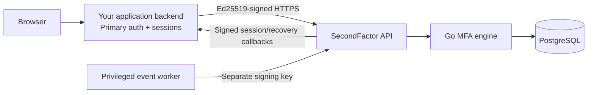

<div align="center">

# 🛡️ SecondFactor
### Self-hosted multi-factor authentication for modern backends

**A Go-powered MFA engine and PostgreSQL-backed API. Use it from Go, NestJS, Rust, or any backend that speaks HTTP.**

[](https://github.com/bwirehq/secondfactor/actions/workflows/ci.yml)
[](https://github.com/bwirehq/secondfactor/releases)
[](https://pkg.go.dev/github.com/bwirehq/secondfactor)
[](LICENSE)

[Quickstart](docs/quickstart.md) · [Integrations](docs/integrations.md) · [API](docs/api.md) · [Security](docs/security.md) · [Report a vulnerability](SECURITY.md)

</div>

---

**SecondFactor adds MFA to your existing login system.** Your app still owns primary authentication, sessions and authorization. SecondFactor provides TOTP enrollment, verification, recovery, proofs and factor management. Embed the Go module or deploy a dedicated HTTPS service.

## ✨ Features

| | Capability |
|---|---|
| 🔐 | Authenticator TOTP: six digits, 30-second steps and clock tolerance |
| 🗝️ | Ten one-time, high-entropy recovery codes stored only as hashes |
| 🔄 | Atomic replay prevention with PostgreSQL transactions and row locking |
| ⏱️ | Session-bound access and fresh-action proofs with expiry and factor-version checks |
| 🛡️ | Assisted recovery with independent authorization and confirmed session revocation |
| 🔒 | AES-GCM secret encryption, key rotation and database-backed rate limits |
| 🧩 | A native Go library, signed HTTP API, and backend-only TypeScript/Rust clients |

**Not an identity provider.** SecondFactor does not register users, replace login, decide account recovery permissions, or send notification emails. **TOTP is not phishing-resistant.** Passkeys are not included in v0.1.0.

## 🚀 Try the HTTPS demo

Requires Go 1.26.10+, Docker Compose, OpenSSL and Python 3.

```sh
git clone https://github.com/bwirehq/secondfactor.git
cd secondfactor
sh scripts/dev-setup.sh
docker compose up --build -d
python3 scripts/smoke.py
```

This generates disposable development keys and starts PostgreSQL, the MFA API and an HTTPS mock-login application. The smoke test covers enrollment, confirmation, verification, a protected route, recovery-code regeneration and logout. **Do not use the mock identity system in production.** See the [quickstart](docs/quickstart.md) for manual authenticator setup.

## 📦 Integration options

| Backend | Integration | Distribution |
|---|---|---|
| **Go** | Embedded module or signed HTTP client | Published Go module |
| **TypeScript / NestJS** | Backend-only signed SDK | Source in `sdk/typescript` |
| **Rust** | Backend-only signed SDK | Source in `sdk/rust` |
| **Python / other** | Signed JSON API and OpenAPI | Protocol documentation |

```sh
go get github.com/bwirehq/secondfactor@v0.1.0
```

> **Release note:** `v0.1.0` is the published baseline. The security hardening in this pull request is **unreleased** and is not included in that tag. After review and merge, publish a new immutable patch release (for example `v0.1.1`) before recommending these new protections to version-pinned consumers.

**The TypeScript and Rust clients are not published to npm or crates.io.** Do not install an unrelated package with a similar name. Keep application signing seeds on trusted backends, never in browsers.

## 🧭 How it works



The standalone service verifies active primary sessions through authenticated application callbacks. Privileged outbox delivery uses **separate worker keys**, and production callback receivers must implement durable, atomic replay protection. See [callback and worker security](docs/callback-replay.md).

## 📚 Documentation

| Guide | Contents |
|---|---|
| [Quickstart](docs/quickstart.md) | Local setup and protected route |
| [Architecture](docs/architecture.md) | Core/service separation and trust model |
| [Integrations](docs/integrations.md) | Go, NestJS, Rust, language-neutral HTTP |
| [API](docs/api.md) and [OpenAPI](docs/openapi.yaml) | Endpoints, schemas and errors |
| [Configuration](docs/configuration.md) | Signing keys, issuers, TLS and limits |
| [Recovery](docs/recovery.md) | Recovery grants, session generations and revocation |
| [Security](docs/security.md) | Cryptographic and deployment assumptions |
| [Key rotation](docs/key-rotation.md) | Safe re-encryption |
| [Coding agents](docs/for-coding-agents.md) | Trusted integration requirements |
| [Troubleshooting](docs/troubleshooting.md) | Common setup problems |

## ✅ Quality and contributions

[CI](.github/workflows/ci.yml) checks Go unit/PostgreSQL integration and concurrent replay tests, race detection, vet, vulnerability scans, TypeScript/Rust builds and tests, audits, secret scanning and a deployed HTTPS smoke test. CI passing does **not** replace independent review of security-critical infrastructure.

Contributions: [CONTRIBUTING.md](CONTRIBUTING.md). Vulnerabilities: [private reporting policy](SECURITY.md). License: [MIT](LICENSE).
