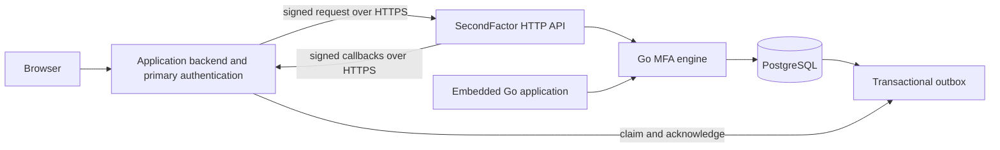

# Architecture

Primary authentication stays in the application. The application backend calls SecondFactor after resolving an authenticated user and session. SecondFactor queries authoritative session state, then applies an application-scoped PostgreSQL transaction.

The root library owns cryptographic state, replay, rate limits, proofs, and factor lifecycle. `transport` owns JSON parsing and authentication boundaries. `integration` owns authenticated callbacks and safe network dialing. `client` and language SDKs own transport/signing only.

Every factor and security record belongs to an application. Composite keys/foreign keys and query predicates enforce application scope. Signing keys are provisioned out of band by operators. Applications do not self-register through a public API.

Each verification consumes database-backed admission budgets before the factor transaction. The factor row is locked before checking replay and lifecycle state. Expected failures commit counters in that same transaction; database failures roll back. No transaction acquires a second pool connection.

Callbacks run outside factor transactions. Assisted recovery uses persisted jobs and an idempotent revocation handshake rather than a distributed transaction. Outbox events and state changes commit together.

The Go HTTP example uses intentionally ephemeral in-memory primary sessions. Production applications must provide durable, authoritative session and revocation implementations.

Outbox event claiming and acknowledgment use a **separate signing-key class** from end-user MFA operations, with no implicit privilege escalation. Receiving application callback handlers must atomically reject signed request replay using durable application-owned storage, such as `integration.PostgresReplayGuard`. See [callback security](callback-replay.md).
